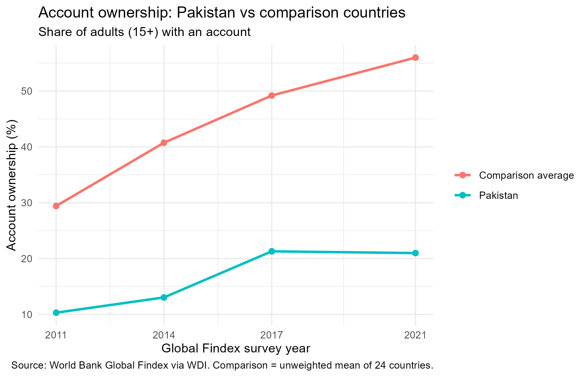
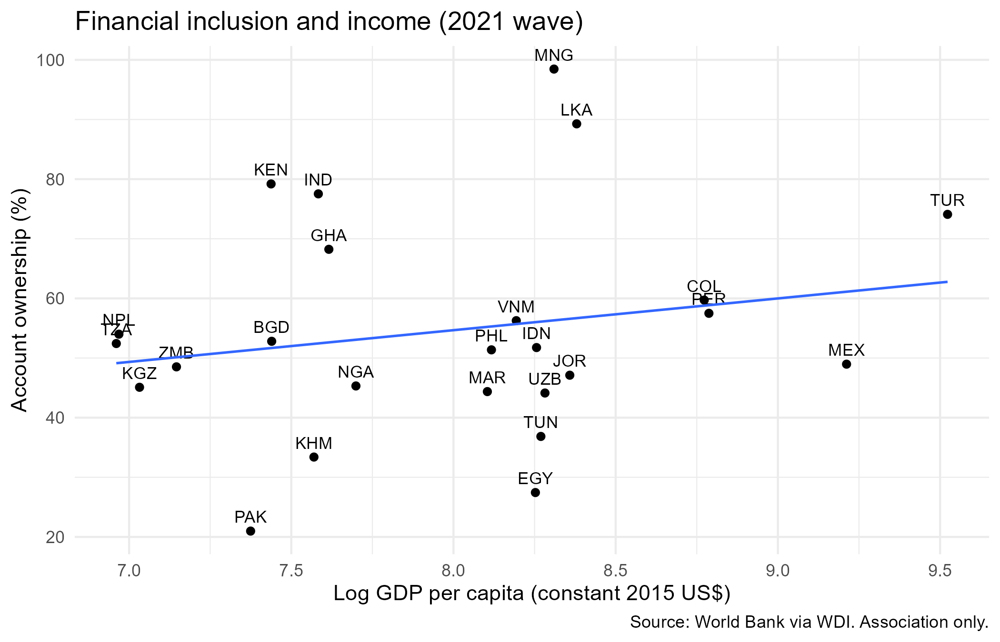

# Digital Financial Inclusion and Income: Pakistan in Comparative Context

This project looks at financial inclusion in Pakistan and compares it with 24 other developing and emerging economies. I used R to analyse World Bank data and explore how account ownership differs across countries and how it relates to income levels.

## 1. Research question

I wanted to explore two main questions:

- How does Pakistan compare with other developing economies in terms of financial inclusion?
- Is there a relationship between financial inclusion and income per person?

## 2. Data used

I collected the data from the World Bank's World Development Indicators (WDI) and Global Findex Database using the WDI package in R.

The study covers 25 countries and uses four Global Findex survey years: 2011, 2014, 2017 and 2021.

The main variable is account ownership among adults aged 15 and above. I also collected information on GDP per capita, mobile subscriptions, internet use, private-sector credit, trade and school enrolment.

Mexico and Vietnam have 2022 survey observations, which I treated as their latest survey wave in the comparison.

## 3. What I did

I used R to:

1. Download and organise the World Bank data.
2. Clean the dataset and prepare it for analysis.
3. Compare Pakistan's account ownership with the average of the other countries.
4. Create graphs to show the differences between countries.
5. Examine the relationship between account ownership and income.
6. Run regression models to see whether the relationship remains after adding other variables and country and year fixed effects.

## 4. Main findings

A few results stood out in the analysis:

- Pakistan had the lowest account ownership in the group of 25 countries in the 2021 wave, at around 21%.
- The comparison-group average was approximately 56%.
- Pakistan's account ownership increased between 2011 and 2017 but showed almost no change in 2021.
- The difference between Pakistan and the comparison-group average increased from 19.1 percentage points in 2011 to 35 percentage points in 2021.
- In the 2021 cross-country analysis, income alone did not explain much of the difference in account ownership between countries.

The regression results also showed that the relationship between account ownership and income was not statistically significant in the models with additional controls and fixed effects.


## 5. Pakistan and the comparison group
| Year | Comparison average | Pakistan |
|---|---:|---:|
| 2011 | 29.4% | 10.3% |
| 2014 | 40.7% | 13.0% |
| 2017 | 49.2% | 21.3% |
| 2021 | 56.0% | 21.0% |

## 6. Figures





## 7. Limitations

There are some limitations to this study that are important to mention.

- The sample includes only 25 countries, so the results may not represent all developing economies.
- The comparison countries were selected for this project and are not a random sample.
- Global Findex figures are survey estimates and may contain sampling error.
- The analysis identifies relationships between variables. It does not prove that financial inclusion causes economic growth or higher income.
- Some collected indicators were not included in the final models because of missing data or their limited relevance to the analysis.

I would like to explore factors such as the gender gap, access to banking services, digital infrastructure and public trust in financial institutions in future research. These are possible areas for further investigation, not conclusions from this study.
## 8. Repository structure

```
digital-financial-inclusion-pakistan/
├── README.md
├── analysis.R
├── data/
│   ├── panel_clean.csv
│   └── wdi_raw.csv
└── results/
    ├── fig1_pakistan_vs_group.png
    └── fig2_inclusion_vs_income.png
```
## 9. How to reproduce the analysis

The analysis can be reproduced using R or RStudio.

1. Install R and RStudio.
2. Install the required packages:

```r
install.packages(c("WDI", "tidyverse", "fixest", "modelsummary"))
```

3. Open `analysis.R`.
4. Set the working directory to the project folder.
5. Run the script.

The script downloads the data, prepares the dataset and generates the tables and figures.


## 10. Data sources

- World Bank – [World Development Indicators](https://data.worldbank.org/)
- World Bank – [Global Findex Database](https://www.worldbank.org/en/publication/globalfindex)

